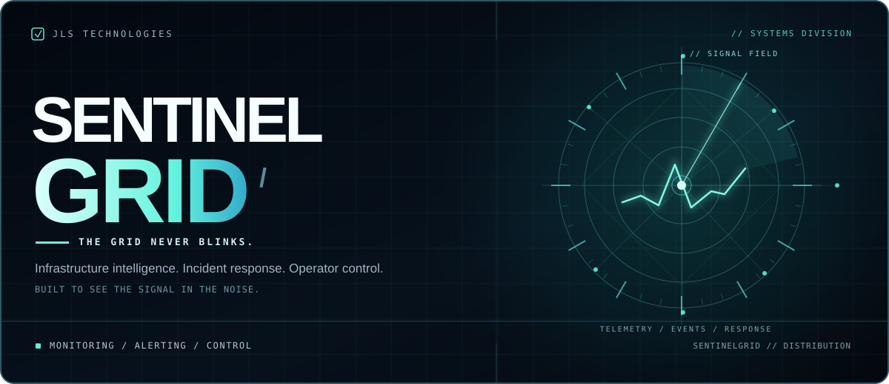
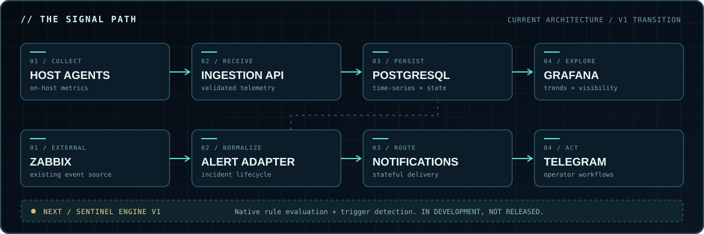

<div align="center">



<br />

<a href="https://github.com/Lurrn2757/sentinelgrid-releases/releases/latest"></a>


<br /><br />

### YOUR INFRASTRUCTURE HAS A PULSE. WE MAKE IT VISIBLE.

**Self-hosted telemetry · Incident workflows · Infrastructure control**

Monitor the systems that matter. Keep the signal when the network fails. Turn incidents into actions instead of another tab nobody checks.

<br />

[**↗ GET THE LATEST RELEASE**](https://github.com/Lurrn2757/sentinelgrid-releases/releases/latest) &nbsp;&nbsp;·&nbsp;&nbsp; [**VIEW ALL BUILDS**](https://github.com/Lurrn2757/sentinelgrid-releases/releases) &nbsp;&nbsp;·&nbsp;&nbsp; [**REPORT AN ISSUE**](https://github.com/Lurrn2757/sentinelgrid-releases/issues)

<sub>PUBLIC DISTRIBUTION CHANNEL // ENGINEERING BY JLS TECHNOLOGIES LLP</sub>

</div>

---

### `01 // MISSION BRIEF`

# MONITOR EVERYTHING THAT MATTERS.

Infrastructure failure rarely announces itself politely. It starts with a spike, a missed heartbeat, an unreachable host, or a service quietly turning into a very expensive paperweight.

**SentinelGrid** brings telemetry collection, alert handling, and operator workflows together in a self-hosted platform designed for real infrastructure, including Linux hosts and Proxmox environments.

The goal isn't another wall of graphs. It's a shorter path between **something is wrong** and **someone can do something about it**.

<table>
<tr>
<td width="50%" valign="top">

<strong><code>01 / OBSERVE</code></strong>

Collect host and infrastructure telemetry through SentinelGrid agents and central ingestion. Review historical metrics through Grafana dashboards.

</td>
<td width="50%" valign="top">

<strong><code>02 / SURVIVE</code></strong>

Buffer agent samples locally during interruptions and replay them when connectivity returns, rather than treating every network wobble as an excuse to lose data.

</td>
</tr>
<tr>
<td valign="top">

<strong><code>03 / RESPOND</code></strong>

Track alert state, acknowledgement, silence, recovery, and notification delivery with operational workflows rather than disposable messages.

</td>
<td valign="top">

<strong><code>04 / CONTROL</code></strong>

Use the Telegram operations interface and Proxmox-aware integrations for monitored infrastructure and carefully scoped operator actions.

</td>
</tr>
</table>

---

### `02 // SYSTEM TOPOLOGY`

## THE SIGNAL PATH



The **telemetry pipeline** is independent of Zabbix. Host and infrastructure data flow through SentinelGrid's own collection and ingestion services.

The **current external alert-source integration** uses Zabbix to supply certain infrastructure events. Those events feed SentinelGrid's incident lifecycle and notification workflows.

**Sentinel Engine V1 is being developed to provide native detection and rule evaluation.** It is a roadmap component, not a feature claimed to be present in the current release.

> [!NOTE]
> Zabbix is not required for the core metrics pipeline. Zabbix-generated alert detection still requires an external Zabbix source until native rule evaluation replaces that responsibility.

---

### `03 // CAPABILITY MATRIX`

| SUBSYSTEM | WHAT IT DOES | STATUS |
|:--|:--|:--|
| **Sentinel agents** | Host telemetry, local buffering, delayed replay | `CURRENT` |
| **Ingestion API** | Authenticated metric reception and processing | `CURRENT` |
| **PostgreSQL** | Metric history and operational state persistence | `CURRENT` |
| **Grafana** | Dashboards and historical infrastructure views | `CURRENT` |
| **Alert workflows** | Incident tracking, acknowledgement, silence, recovery, delivery | `CURRENT` |
| **Telegram operations** | Alerts, operator commands, Proxmox-aware workflows | `CURRENT` |
| **Zabbix adapter** | External event-source integration | `CURRENT / TRANSITIONAL` |
| **Sentinel Engine V1** | Native threshold rules, stateful detection, recovery evaluation | `IN DEVELOPMENT` |

<details>
<summary><b>▸ Expand: operating principles</b></summary>
<br />

```text
PRINCIPLE_01  OWN THE TELEMETRY.
PRINCIPLE_02  NO DATA LEFT BEHIND DURING A TRANSIENT OUTAGE.
PRINCIPLE_03  INCIDENTS HAVE STATE. NOT JUST NOTIFICATIONS.
PRINCIPLE_04  AUTHENTICATION IS NOT AN OPTIONAL ACCESSORY.
PRINCIPLE_05  BUILD FOR RECOVERY, NOT JUST THE HAPPY PATH.
PRINCIPLE_06  AUTOMATION MUST REMAIN AUDITABLE AND CONTROLLED.
```

</details>

---

### `04 // DOWNLOAD PROTOCOL`

## DEPLOY THE GRID.

**The current distribution channel is this repository's [GitHub Releases](https://github.com/Lurrn2757/sentinelgrid-releases/releases).** Download packages and installers from a specific published release, not from random mirrors or screenshots of terminal commands.

**01.** Open **[Latest Release ↗](https://github.com/Lurrn2757/sentinelgrid-releases/releases/latest)**.

**02.** Inspect the release notes, supported environment, and asset list. Download the installer or package appropriate to the target machine.

**03.** Verify the provided release checksums before executing an installer. Review scripts before giving them elevated privileges.

**04.** Follow that release's installation instructions on a supported machine. Use a fresh test VM before introducing SentinelGrid to important workloads.

> [!WARNING]
> Existing-install upgrades and automated rollback should not be assumed supported. Read the release's compatibility and migration notes before reinstalling over an existing deployment.

<details>
<summary><b>▸ Expand: minimal download verification example</b></summary>
<br />

For a release that publishes `install.sh` and `checksums.txt`, replace the tag if needed:

```bash
VERSION=v0.1.5
BASE="https://github.com/Lurrn2757/sentinelgrid-releases/releases/download/${VERSION}"

mkdir -p sentinelgrid-download && cd sentinelgrid-download
curl --fail --location --silent --show-error "$BASE/install.sh" -o install.sh
curl --fail --location --silent --show-error "$BASE/checksums.txt" -o checksums.txt

awk '$2 == "install.sh" {print}' checksums.txt | sha256sum --check --status
less install.sh
```

A passing checksum verifies a file against the accompanying manifest, **not** the publisher's identity. Review the script and use the release's documented install procedure for your deployment target.

</details>

---

### `05 // NEXT GENERATION`

## SENTINEL ENGINE // V1

```text
┌─────────────────────────────────────────────────────────────────────┐
│  NATIVE DETECTION CORE                                       [DEV]  │
├─────────────────────────────────────────────────────────────────────┤
│                                                                     │
│  01  THRESHOLD RULES        CPU / RAM / DISK / CUSTOM SIGNALS       │
│  02  HEARTBEAT DETECTION   MISSING AGENTS / STALE TELEMETRY        │
│  03  INCIDENT STATE        PENDING → FIRING → RECOVERED            │
│  04  NOISE CONTROL         DURATION / DEDUPLICATION / HYSTERESIS   │
│  05  DURABLE EVALUATION    RESTART-SAFE RULE AND ALERT STATE       │
│                                                                     │
│  OBJECTIVE: REPLACE THE EXTERNAL TRIGGER ENGINE, NOT THE STACK.     │
└─────────────────────────────────────────────────────────────────────┘
```

**This is the direction, not a shipping feature list.** Sentinel Engine V1 is intended to move infrastructure detection into SentinelGrid while preserving the telemetry, storage, alert lifecycle, and operator integrations already in place.

The first milestone is simple to describe and difficult to fake: **turn off Zabbix, keep collecting metrics, detect real problems, produce one actionable incident, and resolve it correctly.**

---

### `06 // DISTRIBUTION INTELLIGENCE`

<details>
<summary><b>▸ Is this the source-code repository?</b></summary>
<br />

No. **`sentinelgrid-releases`** is the public distribution channel for packaged releases, installers, checksums, and user-facing documentation. Development source is maintained separately.

</details>

<details>
<summary><b>▸ Is SentinelGrid dependent on Zabbix?</b></summary>
<br />

The agent-to-ingestion-to-database telemetry path is independent. Today's Zabbix integration provides external infrastructure trigger events. Sentinel Engine V1 is being developed to replace that trigger-generation role.

</details>

<details>
<summary><b>▸ Can I deploy it over Proxmox?</b></summary>
<br />

SentinelGrid includes Proxmox-aware monitoring and operational integrations. Start with a supported Linux VM or dedicated test environment, then validate credentials, permissions, recovery, and any enabled infrastructure mutations before using production hosts.

</details>

<details>
<summary><b>▸ Is this ready for unattended enterprise-wide deployment?</b></summary>
<br />

Not a claim this repository makes. Validate your target environment, backups, restore procedures, monitoring behavior, and release-specific limitations first. Production readiness is a measured outcome, not a badge.

</details>

---

<div align="center">

### `// END TRANSMISSION`

# THE GRID NEVER BLINKS.

**Detect early. Understand faster. Respond deliberately.**

[**↓ RELEASES**](https://github.com/Lurrn2757/sentinelgrid-releases/releases) &nbsp; / &nbsp; [**⚑ ISSUES**](https://github.com/Lurrn2757/sentinelgrid-releases/issues)

<br />

<sub><b>SENTINELGRID</b> · ENGINEERED BY JLS TECHNOLOGIES LLP · © 2026</sub>

</div>
